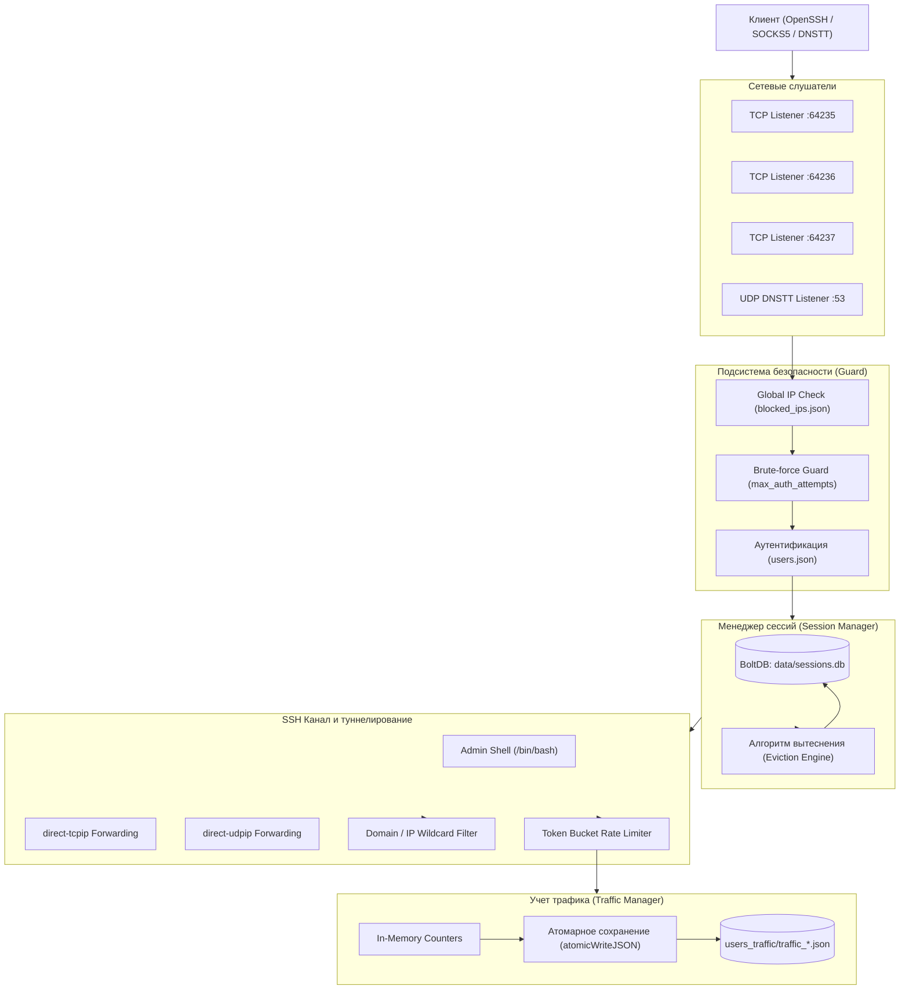

# Архитектура и внутреннее устройство Abdal 4iProto Server

В этом документе приводится подробное описание архитектуры, многопоточной модели, сетевых подсистем и ключевых алгоритмов сервера **Abdal 4iProto Server**.

---

## 1. Общая архитектурная схема

Сервер построен по модульному принципу на языке Go с использованием конкурентной модели горутин (Goroutines) и каналов (Channels).



---

## 2. Модульная структура кодовой базы

- [`core/app`](file:///home/imperator/projects/home/agy/4iproto-server/core/app): Точка входа приложения, инициализация слушателей, перехват сигналов ОС (`SIGINT`, `SIGTERM`) и координация Graceful Shutdown.
- [`core/config`](file:///home/imperator/projects/home/agy/4iproto-server/core/config): Загрузка, валидация и нормализация конфигураций (`server_config.json`, `users.json`, `blocked_ips.json`).
- [`core/security`](file:///home/imperator/projects/home/agy/4iproto-server/core/security): Подсистема Guard (защита от брутфорса), проверка черных списков IP, фильтрация целевых доменов и IP по маскам wildcard.
- [`core/session`](file:///home/imperator/projects/home/agy/4iproto-server/core/session): База данных BoltDB (`sessions.db`), отслеживание активных соединений, алгоритм вытеснения сессий (Session Eviction).
- [`core/ssh`](file:///home/imperator/projects/home/agy/4iproto-server/core/ssh): Реализация SSHv2 сервера, обработчики каналов `direct-tcpip`, `direct-udpip` и терминала `session`.
- [`core/traffic`](file:///home/imperator/projects/home/agy/4iproto-server/core/traffic): Учет байтов в реальном времени, проверка квот `max_total_mb`, атомарное сохранение на диск.
- [`core/network`](file:///home/imperator/projects/home/agy/4iproto-server/core/network): Шейпинг скорости по алгоритму Token Bucket (`max_speed_kbps`), буферизация UDP.
- [`core/dnstt`](file:///home/imperator/projects/home/agy/4iproto-server/core/dnstt): Модуль DNS-туннелирования (Noise protocol over DNS queries).

---

## 3. Обработка сетевых протоколов

### `direct-tcpip` (RFC 4254)
1. Клиент (например, OpenSSH с флагом `-D 1080` или браузер через SOCKS5) запрашивает открытие канала типа `direct-tcpip` к целевому адресу и порту (например, `target.com:443`).
2. Сервер проверяет права пользователя:
   - Если домен или IP входит в `blocked_domains` / `blocked_ips` пользователя — канал отклоняется кодом `SSH_OPEN_ADMINISTRATIVELY_PROHIBITED`.
   - Если пользователь исчерпал квоту `max_total_mb` — канал отклоняется.
3. Сервер устанавливает исходящее TCP-соединение к целевому хосту и связывает потоки ввода-вывода (Go `io.Copy`) через шейпер скорости Token Bucket.

### `direct-udpip` (Расширение для UDP)
Поскольку стандартный протокол SSH изначально не имеет встроенного мультиплексирования UDP, сервер реализует расширение `direct-udpip`:
- Выделяется сокетный буфер (`udp_socket_buffer_kb`, по умолчанию 4 МБ).
- Создается ассоциация с отслеживанием времени жизни пакетов (`udp_idle_timeout_seconds`, по умолчанию 120 с).
- Поддерживает голосовую связь (VoIP), онлайн-игры и DNS-запросы клиентов.

### DNSTT over DNS (Порт 53)
Для сетей с жесткой фильтрацией (где заблокированы все TCP-порты, кроме белых списков):
- Клиент кодирует данные туннеля в base32 и отправляет в виде стандартных DNS-запросов типа `A` или `TXT` к домену NS.
- Модуль DNSTT на сервере слушает порт 53 UDP, расшифровывает полезную нагрузку протоколом Noise и проксирует трафик в локальный SSH-стек.

---

## 4. Алгоритм вытеснения сессий (Session Eviction)

### Проблема «залипания» мобильных сессий
В мобильных сетях (3G/LTE/5G) при переходе между вышками или переключении на Wi-Fi операционная система устройства часто инициирует новое TCP-соединение, при этом старое соединение на сервере не получает TCP FIN/RST и остается открытым (`ESTABLISHED`) до истечения системных таймаутов (до 24 часов). 

Если у пользователя задан параметр `"max_sessions": 1`, повторное подключение отклонялось с ошибкой `max_sessions reached`.

### Иерархия и логика работы
Алгоритм вытеснения разрешает эту проблему без ручного вмешательства администратора:

1. **Определение политики:**
   - Если у пользователя в `users.json` задано поле `evict_on_max_sessions` (`true` или `false`), используется персональная настройка.
   - Если поле не задано (`null`), используется серверное значение `evict_on_max_sessions` из `server_config.json`.
2. **Проверка лимита при авторизации:**
   - Сервер запрашивает число активных сессий пользователя в BoltDB.
   - Если `ActiveCount < MaxSessions`: сессия регистрируется штатно.
   - Если `ActiveCount >= MaxSessions` и вытеснение выключено: соединение отклоняется с ошибкой.
   - Если `ActiveCount >= MaxSessions` и вытеснение **включено**:
     1. Менеджер сессий находит сессию пользователя с самой старой меткой `LastSeen`.
     2. Сервер инициирует принудительное закрытие SSH-канала старой сессии (`session.Close()`).
     3. Старая запись удаляется из BoltDB.
     4. Новое входящее соединение занимает освободившийся слот и мгновенно подключается.

---

## 5. Шейпинг трафика (Token Bucket)

Ограничение скорости (`max_speed_kbps`) реализовано через алгоритм **Token Bucket** в модуле [`core/network/limiter.go`](file:///home/imperator/projects/home/agy/4iproto-server/core/network/limiter.go):
- Каждому активному пользователю с `max_speed_kbps > 0` выделяется «корзина токенов».
- Токены пополняются каждую миллисекунду пропорционально настроенной скорости.
- При чтении и записи каждого пакета проверяется наличие токенов: если токенов недостаточно, горутина засыпает на точно рассчитанный интервал времени.
- Это обеспечивает плавную передачу трафика без всплесков и перегрузки сетевого стека.

---

## 6. Отказоустойчивое сохранение статистики (Atomic Writes)

Для исключения повреждения файлов статистики (`users_traffic/traffic_<username>.json`) при внезапной перезагрузке сервера или сбое питания в функции `SaveTraffic` реализован механизм двухфазной атомарной записи:

```go
func atomicWriteJSON(path string, v interface{}) error {
    tmp := fmt.Sprintf("%s.tmp.%d", path, time.Now().UnixNano())
    data, err := json.MarshalIndent(v, "", "  ")
    if err != nil {
        return err
    }
    if err := os.WriteFile(tmp, data, 0644); err != nil {
        return err
    }
    return os.Rename(tmp, path) // Атомарный системный вызов POSIX rename
}
```

Файл пишется во временный файл на том же разделе диска, после чего системный вызов `os.Rename` атомарно заменяет целевой файл. Даже при аварийной остановке сервера файл конфигурации или статистики никогда не окажется нулевого размера.
